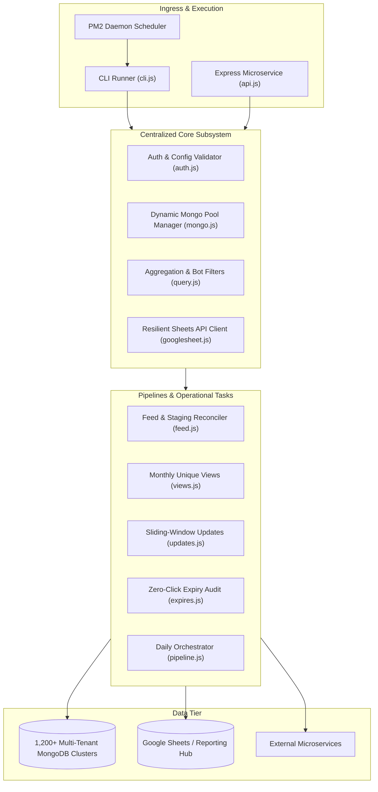

# System Architecture & Technical Specifications

This document outlines the architectural patterns, concurrency controls, database federation model, and data pipeline design implemented in **`antigravity-nodejs`**.

---

## 1. High-Level Architectural Overview

The system is structured as a decoupled, multi-runtime service offering two execution modalities:
1. **Headless CLI & Daemon Runtime**: Controlled via `cli.js` and orchestrated through PM2 cron hooks.
2. **REST API Microservice Runtime**: Lightweight Express server with structured JSON logging (`pino`), non-blocking async job triggers, and live telemetry endpoints.

---

## 2. Distributed Database Federation & Pooling

### 2.1 Dynamic Connection Multiplexing
Connecting individually to 1,200+ databases without pooling causes socket exhaustion and memory leaks. The universal MongoDB manager ([core/mongo.js](file:///c:/Users/JOBIAK/Documents/Antigravity-Python-Nodejs/core/mongo.js)) implements:
- **LRU Client Caching**: Maintains active connections keyed by cluster URI. Multiple database operations targeting the same host share the underlying connection pool.
- **Lazy Initialization**: Connections are only instantiated upon demand and kept alive for reuse across pipeline stages.
- **Graceful Teardown**: Intercepts `SIGINT` and `SIGTERM` signals to cleanly drain open connections before process termination.

### 2.2 Concurrency & Throttling
- **`p-limit`**: Enforces strict ceiling constraints on simultaneous network requests to protect MongoDB clusters and Google APIs from rate limiting or CPU saturation.
- **`p-retry`**: Automatic exponential backoff for transient network timeouts and Google Sheets 429 quota exceptions.

---

## 3. Pipeline Mechanics & Algorithms

### 3.1 Feed Reconciliation (`scripts/feed.js`)
Reconciliation solves state drift between external XML job feeds, staging queues, and production posted collections.
1. Ingests employer job feeds via streaming XML parsing.
2. Cross-references active hashes with existing posted collections.
3. Classifies records into three distinct buckets: `Inserted`, `Updated`, or `Purged`.

### 3.2 Heuristic Bot Filtering (`core/query.js`)
Raw page views are contaminated by search crawlers and scrapers. The query pipeline injects strict exclusion heuristics:
- Filtering known bot User-Agent strings (Googlebot, Bingbot, Yandex, Ahrefs, PetalBot).
- Aggregation by IP + User-Agent within time windows to isolate organic human engagement from automated scrapers.

### 3.3 Zero-Click Expiry (`scripts/expires.js`)
Identifies dead listings that have received zero organic interaction over a configurable sliding window (default 30 days):
- Computes activity metrics against interaction logs.
- Flags listings as inactive or expires them, reducing indexing bloat and search penalty.

---

## 4. Security & Zero-Disclosure Governance

1. **Strict Key Sanitization**: No credentials, database URIs, passwords, or employer tokens are hardcoded.
2. **Environment Isolation**: `.env` and `credentials.json` are excluded from Git via `.gitignore`.
3. **Template Parity**: `clients.example.json` and `.env.example` are maintained in source control to ensure zero drift for new deployments.
