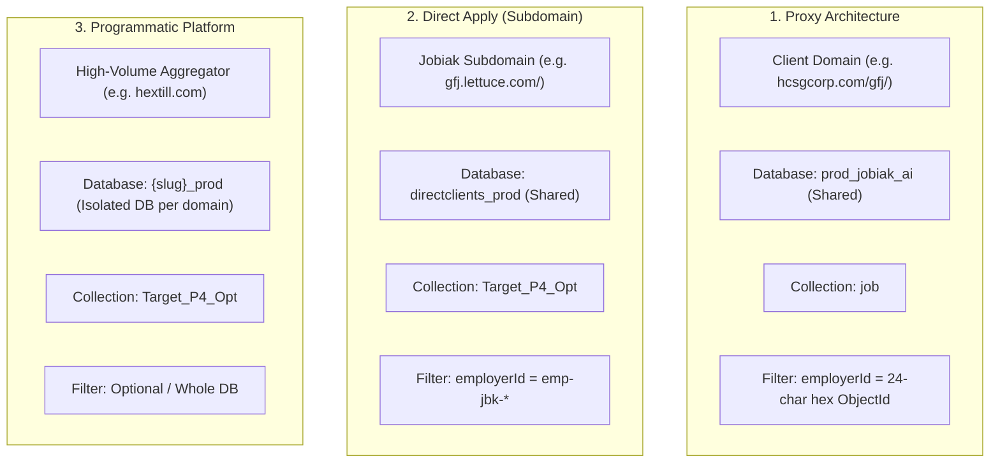

# Jobiak Multi-Tenant Operations & System Architecture Manual

> **The Definitive Engineering & Operations Reference**  
> Covers Google for Jobs schema compliance, GPD workflows, the 3 platform architectures, exact MongoDB aggregation queries, ATS description hygiene, collision prevention, and PM2 automation.

---

## 📑 Table of Contents
1. [Core Mission & System Philosophy](#1-core-mission--system-philosophy)
2. [The 3 Core Platform Architectures](#2-the-3-core-platform-architectures)
3. [Production Database Schemas & Atlas Indexes](#3-production-database-schemas--atlas-indexes)
4. [The 5 Critical Production Dilemmas & Solutions](#4-the-5-critical-production-dilemmas--solutions)
   - [Dilemma 1: Bot vs. Pure Human Google Views](#dilemma-1-bot-vs-pure-human-google-views)
   - [Dilemma 2: ATS Scrape Artifacts & Description Quality](#dilemma-2-ats-scrape-artifacts--description-quality)
   - [Dilemma 3: Ingestion Collision & Duplicate Multiplication](#dilemma-3-ingestion-collision--duplicate-multiplication)
   - [Dilemma 4: 30-Day Zero-Click Expiration (Crawl Budget Protection)](#dilemma-4-30-day-zero-click-expiration-crawl-budget-protection)
   - [Dilemma 5: Multi-Tenant Connection Pooling (1,200+ DBs)](#dilemma-5-multi-tenant-connection-pooling-1200-dbs)
5. [Active Domain Roster & Client Registry (15 Core Domains)](#5-active-domain-roster--client-registry-15-core-domains)
6. [GXC Feed Intelligence (396+ emp-gxc-* Collections)](#6-gxc-feed-intelligence-396-emp-gxc--collections)
7. [Enterprise PM2 Automation & Cron Engine](#7-enterprise-pm2-automation--cron-engine)
8. [Master Dictionary of Jobiak Terms (A–Z)](#8-master-dictionary-of-jobiak-terms-a-z)

---

## 1. Core Mission & System Philosophy

Jobiak is the enterprise technology layer between client Applicant Tracking Systems (ATS) and Google for Jobs. 

The system's daily responsibility is to:
1. Ingest hundreds of thousands of raw job postings from client ATS platforms (Workday, UKG/UltiPro, Taleo, iCIMS, ADP) and external XML feeds.
2. Scrub, sanitize, and normalize descriptions into pristine `schema.org/JobPosting` structured data.
3. Post valid listings to Google for Jobs via reverse proxies (`/gfj/`), subdomains, and programmatic sites.
4. Track organic human impressions and clicks while strictly filtering out search crawlers, spiders, and scrapers.
5. Continuously retire stale zero-click listings to protect Google crawl budget and search domain authority.

---

## 2. The 3 Core Platform Architectures

Every client domain belongs to one of three distinct architectural tiers:



### Comprehensive Architecture Matrix

| Dimension | 1. Proxy | 2. Direct Apply (Subdomain) | 3. Programmatic |
| :--- | :--- | :--- | :--- |
| **URL Pattern** | Reverse-proxied subdirectory (`/gfj/`, `/jobiak/`) on client root | Jobiak-managed subdomain (`gfj.lettuce.com`, `jobs.uncommonschools.org`) | Aggregator domains wholly owned by Jobiak (`hextill.com`, `vertexisle.com`) |
| **MongoDB Database** | `prod_jobiak_ai` *(Shared across all Proxy clients)* | `directclients_prod` *(Shared across all Direct Apply clients)* | `{slug}_prod` *(Dedicated isolated DB per domain, e.g. `hextill_prod`)* |
| **Jobs Collection** | `job` | `Target_P4_Opt` | `Target_P4_Opt` |
| **Analytics Collection**| `userAnalytics` | `userAnalytics` | `userAnalytics` |
| **Google Submit Logs** | `jobsGoogleSubmittedLog` | `aj_jp_google_logs` | `aj_jp_google_logs` |
| **Employer Filter** | **MANDATORY**: `{"employerId": {"$in": ids}}` | **MANDATORY**: `{"employerId": {"$in": ids}}` | **OPTIONAL**: Query whole DB (`{}`) |
| **Job ID in Jobs Col** | `jobId` *(internal)*, `clientJobId` *(maps to staging `uniqueKey`)* | `jobPubJobId` *(public)*, `uniqueKey` *(hash)* | `jobPubJobId`, `uniqueKey` |
| **Job ID in Analytics** | `childJobId` *(joins/views)*, `jobId` *(Proxy clicks)* | `jobPubJobId` | `jobPubJobId` |
| **Expiration Field** | `validThrough` | `pub_expired` | `pub_expired` |
| **Active / Live Filter** | `{"status": "posted", "isActive": true}` | `{"gpost": 5, "job_status": {"$ne": 3}}` | `{"gpost": 5, "job_status": {"$ne": 3}}` |
| **Feed Expired Filter** | `data_cleansing.ETL_AUD_Data (Type: 0)` | `{"job_status": 3}` | `{"job_status": 3}` |
| **Pending / To-Post** | `job_status != 3` in staging minus existing in `job` | `{"gpost": 1, "job_status": {"$ne": 3}}` | `{"gpost": 1, "job_status": {"$ne": 3}}` |

---

## 3. Production Database Schemas & Atlas Indexes

### 3.1 `prod_jobiak_ai.job` (Proxy Master Jobs Collection — 26 Indexes)
```json
{
  "_id": "ObjectId('646790ed9d602a379ef7933c')",
  "jobId": "646790ec9d602a379ef7933a",
  "clientJobId": "cook~~dayton~~oh~~us~~group`healthcare`inc`services",
  "employerId": "6a904f26060e8f0b78b0dc81",
  "domain": "https://hcsgcorp.com",
  "submittedUrl": "https://hcsgcorp.com/gfj/cook-dayton-oh-646790ec9d602a379ef7933a",
  "title": "Cook",
  "company": "Healthcare Services Group, Inc.",
  "location": "Dayton,OH,US",
  "datePosted": "2026-11-11T10:34:58.397Z",
  "validThrough": "2026-12-09T10:34:58.397Z",
  "status": "posted",
  "isActive": true,
  "createdAt": "2023-05-19T15:07:05.534Z"
}
```
**Critical Compound Indexes:**
- `employerId_1_isActive_1_status_1` *(Primary active query filter)*
- `employerId_1_clientJobId_1` *(Pre-posting collision detection)*
- `isActive_1_status_1_employerId_1_jobId_1`
- `employerId_1_title_1_status_1_isActive_1`

---

### 3.2 `jobicarenode_prod.Target_P4_Opt` (Staging Queue Collection)
```json
{
  "_id": "ObjectId('644147112fe99409181dbf0c')",
  "employerId": "emp-jicn-hcsg",
  "jobtitle": "Cook",
  "uniqueKey": "cook~~dayton~~oh~~us~~group`healthcare`inc`services",
  "gpost": 5,
  "job_status": 2,
  "action": "post",
  "city": "Dayton",
  "state": "OH",
  "country": "US"
}
```
**Critical Compound Indexes:**
- `employerId_1_job_status_1_gpost_1` *(Staging candidate filter)*
- `employerId_1_uniqueKey_1_job_status_1` *(Collision lookup)*

---

### 3.3 `prod_jobiak_ai.userAnalytics` (Interaction Telemetry Collection)
```json
{
  "_id": "ObjectId('644147422fe99409181dbf99')",
  "employerId": "6a904f26060e8f0b78b0dc81",
  "childJobId": "646790ec9d602a379ef7933a",
  "jobId": "646790ec9d602a379ef7933a",
  "domain": "hcsgcorp.com",
  "ipAddress": "74.125.214.101",
  "isBot": false,
  "isFromGoogle": true,
  "browserType": "Chrome",
  "deviceType": "Mobile",
  "createdDt": "2026-11-11T14:22:10.000Z"
}
```

---

## 4. The 5 Critical Production Dilemmas & Solutions

### Dilemma 1: Bot vs. Pure Human Google Views
- **Why**: Search bots (Googlebot, Bingbot, Yandex, Ahrefs, PetalBot) crawl proxy pages constantly. Including bot visits inflates client billing numbers and distorts conversion metrics.
- **What**: Every valid organic interaction must be proven human and originate from Google for Jobs.
- **The Exact 4-Condition Human Query**:
  ```javascript
  {
    "employerId": "6a904f26060e8f0b78b0dc81",
    "isBot": false,
    "browserType": { "$ne": "Unknown" },
    "deviceType": { "$ne": "Unknown" },
    "isFromGoogle": true,
    "createdDt": {
      "$gte": ISODate("2026-11-01T00:00:00Z"),
      "$lt":  ISODate("2026-12-01T00:00:00Z")
    }
  }
  ```
- **Deduplication Formula (DB_Clicks)**:
  ```javascript
  // Deduplicates multiple clicks from the same IP on the same job into 1 unique view
  { $group: { _id: { ip: "$ipAddress", job: "$jobId" } } },
  { $count: "DB_Clicks" }
  ```

---

### Dilemma 2: ATS Scrape Artifacts & Description Quality
- **Issue**: Client ATS systems inject scrape headers, timestamps, unclosed tags, and outbound career links into raw description HTML.
- **Google Penalties**:
  1. **Snippet Ruined**: Google uses the first 160 characters for the search card preview. A leading timestamp (`"Posted Wednesday, August 26, 2026, 4:00 AM..."`) makes the listing appear months old, destroying candidate CTR.
  2. **Conversion Leaks**: Disclaimers stating *"visit client.com/careers directly"* divert applicants away from tracked proxy pages (`/gfj/`), ruining reported ROI.
- **The Solution (`core/gfjSchema.js`)**:
  - `cleanJobDescription(desc)` automatically applies:
    - `RX_POSTED_PREFIX` stripping leading scrape timestamps.
    - `RX_STRAY_DOT` removing `<p><strong>.</strong></p>` rendering bugs.
    - Trailing street address pruning (deleting plain text hanging after the final `>`).
    - `RX_APPLY_LEAKS` scrubbing direct-apply bypass text.

---

### Dilemma 3: Ingestion Collision & Duplicate Multiplication
- **Issue**: When promoting jobs from staging (`jobicarenode_prod.Target_P4_Opt`) to production (`prod_jobiak_ai.job`), posting duplicate keys creates multiple active URLs for the exact same job in Google, triggering spam down-ranking.
- **The Rule**: **"If a candidate uniqueKey is already present in `prod_jobiak_ai.job`, WE CANNOT POST!"**
- **The Mapping**:
  $$\text{Target\_P4\_Opt.uniqueKey} \longleftrightarrow \text{job.clientJobId}$$
- **The Solution (`scripts/collision.js`)**:
  - Batches staging `uniqueKeys` in sets of 500.
  - Queries `job.clientJobId` in production.
  - Returns `availableToPost` (keys not yet in production) vs `alreadyInProduction` (colliding keys).

---

### Dilemma 4: 30-Day Zero-Click Expiration (Crawl Budget Protection)
- **Why**: Google allocates a finite crawl budget per domain. Retaining thousands of zero-engagement jobs dilutes search ranking and slows indexation of fresh postings.
- **The Formula**:
  $$\text{To Expire} = \text{Active Posted Jobs (> 30 days old)} - \text{Jobs with Pure Human Clicks}$$
- **The Solution (`scripts/expires.js`)**:
  - Identifies jobs where `datePosted < 30 days ago`.
  - Checks `userAnalytics` under the pure human filter.
  - Marks non-performing listings as `status: "expired"`, `isActive: false`.

---

### Dilemma 5: Multi-Tenant Connection Pooling (1,200+ DBs)
- **Issue**: Creating new MongoDB client connections across 1,200+ tenant clusters causes socket exhaustion, high memory usage, and connection timeouts.
- **The Solution (`core/mongo.js`)**:
  - Dynamic LRU client connection pool.
  - Reuses underlying socket connections across identical cluster URIs.
  - Signals interceptors (`SIGINT`, `SIGTERM`) cleanly drain connections on process termination.

---

## 5. Active Domain Roster & Client Registry (15 Core Domains)

| Domain | Type | Database | Jobs Collection | Employer ID Filter |
| :--- | :--- | :--- | :--- | :--- |
| `hcsgcorp.com/gfj/` | Proxy | `prod_jobiak_ai` | `job` | `"6a904f26060e8f0b78b0dc81"` |
| `abskids.com/gfj/` | Proxy | `prod_jobiak_ai` | `job` | `"6aa8d214060e8f0b78b0dc87"` |
| `concentrix.com/gfj/` | Proxy | `prod_jobiak_ai` | `job` | `"6a8871d1060e8f0b78b0dc69"` |
| `qrmhealth.com/gfj/` | Proxy | `prod_jobiak_ai` | `job` | `"6a7b516d060e8f0b78b0dc5a"` |
| `yescommunities.com/gfj/` | Proxy | `prod_jobiak_ai` | `job` | `"6a86c3d7060e8f0b78b0dc66"` |
| `championwindow.com/gfj` | Proxy | `prod_jobiak_ai` | `job` | `"5f16b7fba780b2085c230ea1"` |
| `imperialsupplies.com/jobiak` | Proxy | `prod_jobiak_ai` | `job` | `"5e6f1017a780b23e130a1c3b"` |
| `usjobsplacement.com/gfj/` | Proxy | `prod_jobiak_ai` | `job` | `"6a62444b060e8f0b78b0dc1a"` |
| `earnhaus.com/gfj/` | Proxy | `prod_jobiak_ai` | `job` | `"68b8133b060e8f5df1a6c3a7"` |
| `suncrestcare.com/gfj/` | Proxy | `prod_jobiak_ai` | `job` | `"6ad8dd02060e8f0b78b0dc9a"` |
| `gfj.lettuce.com/` | Direct Apply | `directclients_prod` | `Target_P4_Opt` | `"emp-jbk-lettuce"` |
| `gfj.apexfocusgroup.com` | Direct Apply | `directclients_prod` | `Target_P4_Opt` | `["emp-jbk-apexfocusgroup", "emp-jbk-apexfocusgroup_uk"]` |
| `gfj.levelsurveys.com` | Direct Apply | `directclients_prod` | `Target_P4_Opt` | `"emp-jbk-levelsurveys"` |
| `hextill.com` | Programmatic | `hextill_prod` | `Target_P4_Opt` | Whole DB (`{}`) |
| `vertexisle.com` | Programmatic | `vertexisle_prod` | `Target_P4_Opt` | `["emp-vxi-earnhaus", "emp-vxi-focusgrouppanel"]` |

---

## 6. GXC Feed Intelligence (`generateXml_prod`)

- **396+ Collections**: All collections named `emp-gxc-*` store title-wise XML syndication feeds.
- **Major Accounts Tracked**: Albertsons, Gopuff, DoorDash, Uber, Grubhub.
- **Normalization Heuristic**:
  - `ubereats`, `uber eats`, `uber` $\rightarrow$ Normalized to canonical labels.
  - Cleans raw `$18.50` string formats into numerical float values for CPA/CPC averaging.
- **CLI Inspection**:
  ```bash
  node cli.js gxc compare --company doordash
  ```

---

## 7. Enterprise PM2 Automation & Cron Engine

The enterprise configuration ([pm2/ecosystem.config.cjs](file:///c:/Users/JOBIAK/Documents/antigravity-nodejs/pm2/ecosystem.config.cjs)) orchestrates 5 automated jobs:

| PM2 Service Name | Script & Command | Schedule (IST) | Schedule (UTC) | Purpose |
| :--- | :--- | :--- | :--- | :--- |
| **`jobiak-api`** | `node cli.js serve` | **Always Online** | Always Online | Express microservice (max memory: 600M) |
| **`daily-proxy-pipeline`** | `node cli.js pipeline` | **09:00 AM Daily** | `30 3 * * *` | Sliding-window updates $\rightarrow$ zero-click expiry |
| **`gpd-quality-audit`** | `node cli.js gpd audit` | **10:00 AM Daily** | `30 4 * * *` | Description hygiene audit & scrape artifact check |
| **`ingestion-collision-gate`**| `node cli.js collision` | **11:00 AM Daily** | `30 5 * * *` | Pre-posting collision gate (`uniqueKey` vs `clientJobId`) |
| **`monthly-views-report`** | `node cli.js views --lead tarun` | **01st of Month (08:00 AM)** | `30 2 1 * *` | Monthly billing views export to Google Sheets |

### PM2 Control Commands
```bash
# Start all services
pm2 start pm2/ecosystem.config.cjs

# Check live status & memory
pm2 status

# Open retro terminal dashboard
pm2 monit

# Stream logs
pm2 logs jobiak-api
```

---

## 8. Master Dictionary of Jobiak Terms (A–Z)

* **`childJobId`**: The specific posting instance ID logged in `userAnalytics`. Used to match human views back to the `jobId` in `prod_jobiak_ai.job`.
* **`clientJobId`**: Field in `prod_jobiak_ai.job` storing the exact normalized `uniqueKey` from staging. Primary key used for collision prevention.
* **`cjid`**: Short for *Client Job ID*.
* **`DB_Clicks`**: Jobiak metric representing deduplicated pure human Google clicks (`ipAddress` + `jobId`).
* **`emp-gxc-*`**: Prefix for the 396+ XML syndication collections in `generateXml_prod`.
* **`emp-jicn-*`**: JobiCare employer ID prefix (e.g. `emp-jicn-hcsg`, `emp-jicn-qrm`).
* **`GFJ`**: Google for Jobs search cards platform.
* **`GPD`**: Google Programmatic Distribution (end-to-end ingestion, hygiene, schema formatting, and indexing).
* **`gpost`**: Numerical posting status flag in `Target_P4_Opt`:
  - `1`: Candidate ready for posting / pending.
  - `3`: Update / refresh candidate.
  - `5`: Fully posted and active in Google.
* **`job_status`**: Staging operational flag in `Target_P4_Opt`:
  - `2`: Active / valid listing.
  - `3`: Expired / feed-deleted listing.
* **`uniqueKey`**: Normalized hash string combining lowercased title, location, and company:
  `title~~city~~state~~country~~company`
  *(e.g. `cook~~dayton~~oh~~us~~group`healthcare`inc`services`)*.
* **`validThrough`**: The expiration date in `prod_jobiak_ai.job` (ISO 8601).
